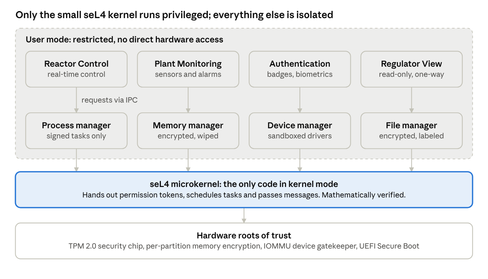
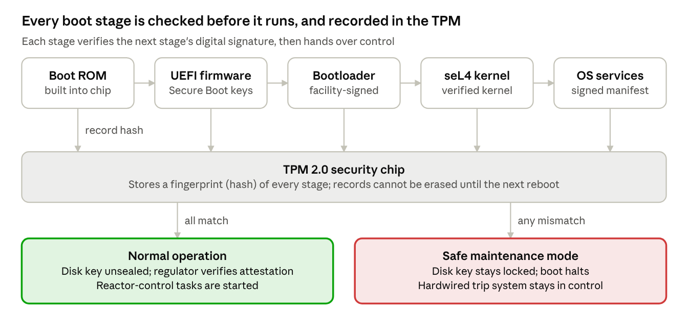

# AEGIS-OS: Secure Operating System Design for a Nuclear Facility

A secure operating system architecture for the computers that run a nuclear
power plant, plus a working demo of its most important piece: a **Secure Boot
chain of trust backed by a TPM 2.0 chip**. Built for CYBR 343 (Operating System
Security).

> **One-line result:** With Secure Boot on, the Linux kernel refused to load my
> unsigned kernel module (`Key was rejected by service`). With Secure Boot off,
> the TPM's **PCR 7** fingerprint changed, proving the tampered boot was
> recorded, and the same unsigned module loaded straight into the kernel.

<!-- IMAGE: demo-secure-boot-on.png - terminal showing "SecureBoot enabled" and "Key was rejected by service" -->
<!--  -->
<!-- *Secure Boot on: the kernel refuses to load unsigned code.* -->

## The problem

In 2010, the **Stuxnet** worm got into Iran's Natanz uranium enrichment plant,
a site with no internet connection. It came in on a USB drive, used drivers
signed with **stolen certificates** so they looked trustworthy, took over the
Siemens controllers that ran the centrifuges, and quietly destroyed about 1,000
of them while showing operators normal readings.

The lesson: being offline is not enough. The operating system itself has to
refuse untrusted code, contain any break-in, and prove it started up cleanly.

## The design: AEGIS-OS

AEGIS-OS is a design (not a finished OS) built on three goals: only trusted code
runs, one broken part can't take down the rest, and safety always comes first
(the reactor's emergency shutdown stays hard-wired, outside any software).


*The seL4 microkernel is the only code with full control. Everything else runs
in isolated partitions with limited rights.*

| Layer | What it does |
|-------|--------------|
| Hardware roots of trust | TPM 2.0 chip, per-partition memory encryption, IOMMU device gatekeeper |
| seL4 microkernel | Formally verified kernel; hands out permissions and passes messages |
| OS services | Process, memory, device, and file managers, each sandboxed |
| Partitions | Reactor Control, Plant Monitoring, Authentication, Regulator View (read-only) |

Other controls covered in the design: two-person approval for safety actions,
AES-256 disk encryption, smart card + PIN + fingerprint logins, a one-way data
diode for outgoing data, ASLR/DEP/guard pages, and append-only audit logs.

### Secure boot comes first


*Each boot stage checks the next stage's signature before handing over control,
and the TPM records a fingerprint of every stage.*

If the fingerprints match, the disk key unlocks and the regulator can confirm
the system remotely. If anything changed, the disk stays locked and the plant
stays in its safe state.

## The demo

The design can't be run as-is (seL4 plus custom partitions is a large build), so
the demo shows the **same Secure Boot and TPM mechanisms** on an Ubuntu Server
virtual machine with UEFI Secure Boot and a virtual TPM 2.0 chip.

| Scene | Command | Secure Boot ON | Secure Boot OFF |
|-------|---------|----------------|-----------------|
| Is Secure Boot active? | `mokutil --sb-state` | `SecureBoot enabled` | `SecureBoot disabled` |
| Load unsigned kernel code | `sudo insmod hello.ko` | `Key was rejected by service` | Loads, and the kernel logs `module verification failed ... tainting kernel` |
| TPM boot fingerprints | `sudo tpm2_pcrread sha256:0,7` | PCR 7 = `6104AFB3...F80FD12` | PCR 7 = `06F35338...2C46392A` (PCR 0 unchanged) |
| Memory randomization (ASLR) | `grep stack /proc/self/maps` (twice) | Different stack address each run | n/a |

**What it proves:**
- **Verified boot works:** with the chain of trust in place, unsigned code is
  blocked, which is exactly how a rootkit or a Stuxnet-style driver would try
  to get in.
- **Measured boot works:** changing the boot configuration changed PCR 7 while
  the firmware measurement (PCR 0) stayed the same. In AEGIS-OS the disk key is
  sealed to these values, so a tampered boot can't unlock the disk.
- **Without the chain of trust, anything gets in:** the same module loads as
  soon as Secure Boot is off.

<!-- IMAGE: demo-pcr-diff.png - diff of pcr-on.txt and pcr-off.txt showing PCR 7 changed -->
<!--  -->
<!-- *Secure Boot off: the TPM's PCR 7 fingerprint no longer matches.* -->

### Watch the demo

[](https://youtu.be/ZO1ou359OJ0)

*Click the image to watch the full demo (about 2.5 minutes).*


**Tested on:** Windows 11 host, VirtualBox 7.2, Ubuntu Server 24.04.5 LTS
(kernel 6.8), EFI firmware with Secure Boot, virtual TPM 2.0.

## Write-up and slides

- **White paper:** [Secure Operating System Design for a Nuclear Facility (PDF)](DANIEL.GUY-%20CYBR343-%20Class%20project%20Secure%20Operating%20System%20Design%20for%20a%20Nuclear%20Facility.pdf),
  covering all 13 design areas (architecture, access control, cryptography,
  secure boot, memory and process management, and more)
- **Presentation:** [AEGIS-OS slides (PDF)](DANIEL.GUY-%20AEGIS-OS%20Presentation.pdf)

## Run it yourself

New to virtual machines? **[GETTING_STARTED.md](GETTING_STARTED.md)** walks
through everything in plain language, from installing VirtualBox to running each
demo scene.

Quick version, for people who've done this before:

1. Create a VirtualBox VM with **EFI**, **Secure Boot**, and **TPM 2.0** enabled,
   and install Ubuntu Server 24.04 LTS (include OpenSSH server).
2. Inside the VM, run the commands in [`setup.sh`](setup.sh). It installs
   `mokutil`, `tpm2-tools`, and kernel headers, and builds an unsigned test
   module at `~/demo/hello.ko`.
3. Follow [`demo-script.md`](demo-script.md): Part A with Secure Boot on, then
   turn it off in the VM's settings and run Part B.

## Repository layout

```
README.md            This page
GETTING_STARTED.md   Plain-language, step-by-step tutorial
setup.sh             Installs the demo tools and builds the unsigned test module
demo-script.md       Scene-by-scene recording script with expected output
docs/images/         Architecture and secure-boot diagrams
DANIEL.GUY- ...pdf   The white paper and the presentation slides
```

## Safety

The VM is a local test machine with no real data. Use your own username and
password when you build it, and don't reuse that password anywhere else. This
repo deliberately leaves out SSH keys, passwords, and the VM itself (see
`.gitignore`).

## References

- CISA, *Primary Stuxnet Advisory* (ICSA-10-272-01)
- IAEA, *Computer Security Techniques for Nuclear Facilities* (NSS 17-T, Rev. 1)
- U.S. NRC, 10 CFR 73.54 and Regulatory Guide 5.71
- NIST SP 800-193, *Platform Firmware Resiliency Guidelines*
- NIST SP 800-82r3, *Guide to Operational Technology (OT) Security*
- seL4 Foundation, *About seL4*; Ubuntu Wiki, *UEFI/SecureBoot*

## Credits

Built with VirtualBox, Ubuntu Server, `mokutil`, and `tpm2-tools`. Built with AI
assistance.
